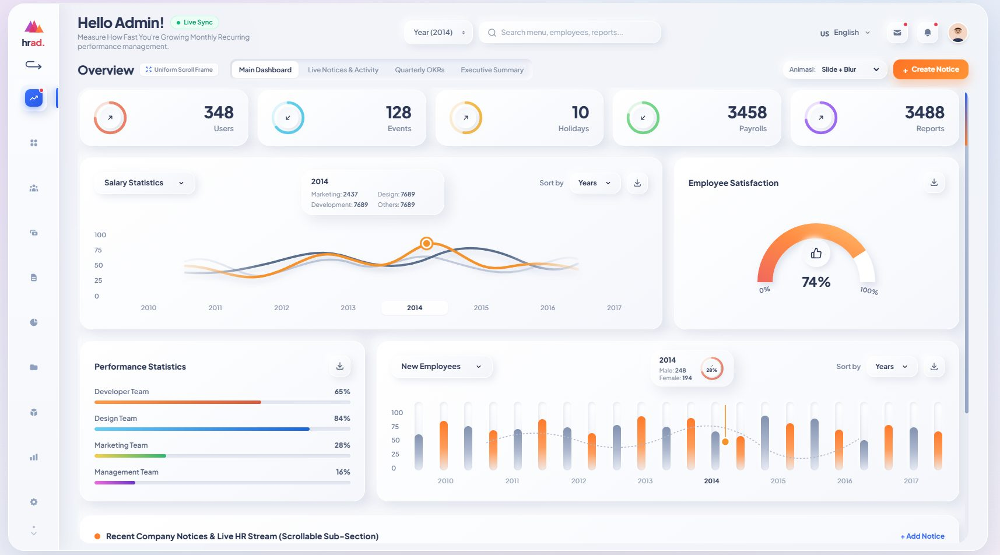

# hrad. — Interactive HR Admin Dashboard Template

A free, open-source **HR Admin Dashboard template** built with vanilla JavaScript + Tailwind CSS. Neumorphic design, animated KPI rings, spline & bar charts, uniform scroll frame, and a fully configurable menu system.

> **Zero build step.** Clone, open `index.html`, done. Perfect for HR admin panels, internal tools, or as a starter for your own dashboard projects.



## ✨ Features

- 🎨 **Neumorphic soft-UI design** with pastel ambient background
- 📊 **Animated data visuals** — KPI progress rings, multi-wave spline chart, capsule bar chart, semi-circular gauge (all pure SVG, no chart library)
- 🧭 **10 configurable sidebar menus** with gliding active indicator + expandable rail
- 🗂️ **Uniform scroll frame** — every menu shares the same viewport; long content scrolls smoothly inside
- 🔄 **4 menu transition styles** (Slide+Blur, Elastic Spring, 3D Flip, Horizontal Glide) switchable at runtime
- 🔍 Global search, year filter, messages & notifications popovers, create-notice modal, toast system
- 🌐 EN/ID language toggle (UI-level)
- 📱 Responsive down to mobile

## 🚀 Quick Start

```bash
git clone https://github.com/<your-username>/hr_admin_dashboard_hrad.git
cd hr_admin_dashboard_hrad
```

Then just open `index.html` in your browser. No `npm install`, no bundler.

Or serve it locally (recommended so the CDN loads consistently):

```bash
npx serve .        # or: python -m http.server 8080
```

## 📁 Project Structure

```
hr_admin_dashboard_hrad/
├── index.html              # Entry page — shell markup, loads Tailwind + 3 JS files
├── README.md
├── LICENSE
└── assets/
    ├── css/
    │   └── styles.css      # Neumorphic surfaces, sidebar glider, animations
    └── js/
        ├── config.js       # ⚙️ EDIT HERE — brand, menus, years, animations
        ├── data.js         # 📊 EDIT HERE — demo datasets (replace with your data)
        └── app.js          # Rendering engine + interactions (rarely needs edits)
```

## 🛠️ Customization Guide

### 1. Rebrand (change name, greeting, colors)

Open **`assets/js/config.js`**:

```js
brand: {
  name: 'hrad.',
  tagline: 'Interactive HR Admin Dashboard',
  wordmark: ['hr', 'ad.'],   // two-tone: [base, accent]
  greeting: 'Hello Admin!',
  subtitle: ['Line one', 'line two']
}
```

Logo colors: edit the gradient stops in the inline SVG inside `index.html`.

### 2. Add / rename a menu

In **`assets/js/config.js`**, edit the `menus` array:

```js
{
  id: 'recruitment',                  // unique id
  title: 'Recruitment Pipeline',      // sidebar + header title
  badge: false,                       // red notification dot
  subMenus: ['Pipeline', 'Openings'], // tab pills
  icon: `<svg ...>...</svg>`          // inline SVG icon
}
```

Then in **`assets/js/app.js`**, either edit the matching `renderXxxScreen()` function or add a new one and register it in the `SCREEN_RENDERERS` map:

```js
const SCREEN_RENDERERS = {
  ...
  recruitment: renderRecruitmentScreen,
};
```

### 3. Replace demo data

In **`assets/js/data.js`**:

- `yearlyData` — keys must match `HRAD_CONFIG.years` in `config.js`
- `employeesList` — directory rows; `status` ∈ `'Active' | 'Remote' | 'On Leave'`
- `notices` — initial broadcast notices

To wire a real API instead, replace these constants in `app.js` with `fetch()` calls and re-run `renderActiveMenuContent()`.

### 4. Change the year range

In **`assets/js/config.js`**, edit `years` and `defaultYear`. The demo charts assume **8 yearly columns** (`grid-cols-8`); adjust that class in `app.js` if you change the count.

## 🌐 Deploy to GitHub Pages (free)

1. Push this repo to GitHub
2. Repo **Settings → Pages → Source: `main` branch, `/ (root)`**
3. Your dashboard is live at `https://<username>.github.io/hr_admin_dashboard_hrad/`

## 🧱 Tech Stack

| Layer      | Choice                                   | Why                                    |
| ---------- | ---------------------------------------- | -------------------------------------- |
| Markup     | HTML5                                    | Single entry, semantic shell           |
| Styling    | [Tailwind CSS (CDN)](https://tailwindcss.com) | Zero build; self-host for production |
| Logic      | Vanilla ES6+ JavaScript                  | No framework, no dependencies          |
| Charts     | Hand-rolled SVG                          | Lightweight, fully customizable        |
| Fonts      | Plus Jakarta Sans + Poppins (Google Fonts) |                                      |

## 🤝 Contributing

Issues and PRs are welcome. Keep the vanilla-JS, no-build philosophy.

## 📄 License

Released under the [MIT License](LICENSE) — free for personal and commercial use.
